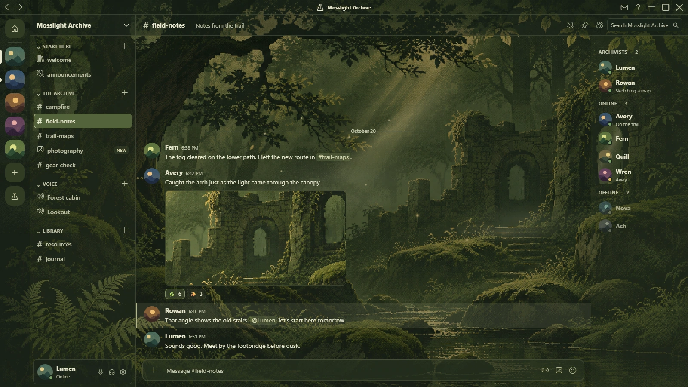
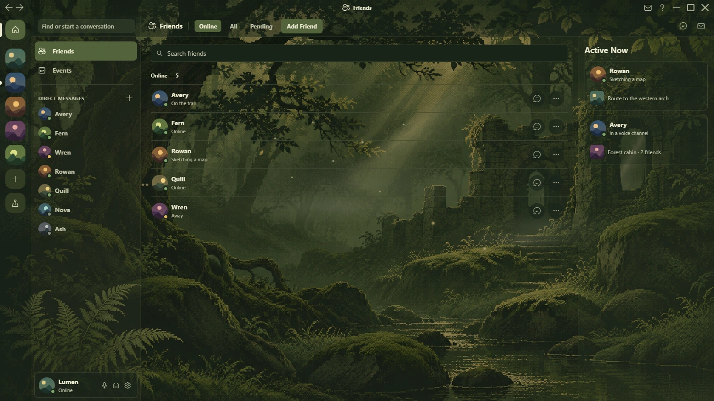
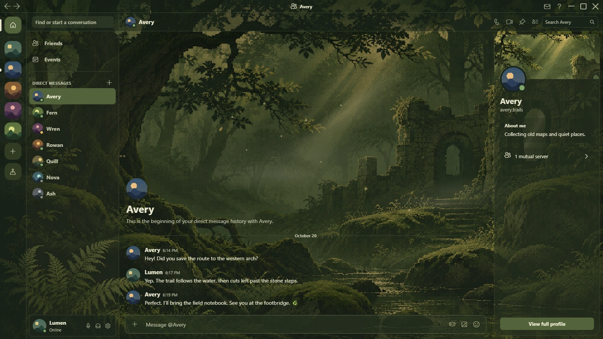

# Golden Moss

<p align="center">A forest theme for BetterDiscord · Лесная тема для BetterDiscord</p>
<p align="center">
  <a href="#english">English</a> · <a href="#русский">Русский</a>
  &nbsp;|&nbsp;
  <a href="./GoldenMoss.theme.css">Download 1.4.3 · Скачать 1.4.3</a>
</p>

[](./previews/server-chat.webp)

| Friends · Друзья | Direct messages · Личные сообщения |
| --- | --- |
| [](./previews/friends.webp) | [](./previews/direct-messages.webp) |

*Previews use Full mode and fictional servers, profiles, and messages. / На превью включён Full, а серверы, профили и сообщения вымышлены.*

## English

### About the theme

Golden Moss gives Discord translucent olive panels, warm text, and golden light over pixel-textured forest ruins. The theme includes mist, sunbeams, floating dust, fireflies, and a pair of blinking eyes in a tree hollow. **Full** also adds an occasional falling leaf.

The CSS contains the 2560 × 1440 lossless wallpaper and works offline with its default settings. [Download the wallpaper separately](./GoldenMoss_original.png)

### Installation

1. Install BetterDiscord for the Discord desktop app. [BetterDiscord](https://betterdiscord.app/)
2. Download [`GoldenMoss.theme.css`](./GoldenMoss.theme.css).
3. In Discord, open **User Settings → BetterDiscord → Themes → Open Themes Folder**. On Windows, this folder is usually `%AppData%\BetterDiscord\themes`.
4. Copy the CSS file into that folder. Enable **GoldenMoss** under **Themes** and choose a dark appearance in Discord.

To update, replace the installed CSS file. Keep personal overrides in **Custom CSS** so they carry over. [BetterDiscord theme guide](https://docs.betterdiscord.app/themes/introduction/quick-start)

### Theme controls

Paste a `:root` block into **User Settings → BetterDiscord → Custom CSS** and save. You can also edit the values in **GOLDEN MOSS — USER CONFIGURATION** near the top of the theme file. Remove the overrides to restore the defaults.

```css
:root {
  --gm-effects-mode: full;
  --gm-eyes-animation: none;
  --gm-chat-opacity: 0.42;
}
```

This selects Full, disables the eyes, and makes the chat background more opaque.

| Value for `--gm-effects-mode` | What it does |
| --- | --- |
| `ambient` | Gentle animation. Default in the downloadable file. |
| `full` | Stronger light and particles, with a falling leaf roughly every 22 seconds. |
| `static` | Stops all wallpaper animation. |

System reduced motion also stops wallpaper animation. To stop a single effect, set its `--gm-…-animation` property to `none`. To change its speed, edit the duration in seconds and keep the rest of the value. A larger duration slows the cycle. Use the matching `--gm-…-opacity` to set its base intensity from `0` to `1`.

- Light and mist use `--gm-rays-animation`, `--gm-arch-ray-animation`, and `--gm-mist-animation`.
- Particles, the leaf, and the eyes use `--gm-dust-animation`, `--gm-fireflies-animation`, `--gm-leaves-animation`, and `--gm-eyes-animation`.

| Setting | Controls |
| --- | --- |
| `--gm-wallpaper-image` | `embedded` for the bundled forest, `none` for a solid color, or `url("https://…")` for a custom image. Effects are mapped to the bundled forest. |
| `--gm-wallpaper-size` | `cover` fills the window and crops the edges. `contain` shows the whole image. |
| `--gm-wallpaper-x`, `--gm-wallpaper-y`, `--gm-wallpaper-dim` | Horizontal alignment, vertical alignment, and wallpaper dimming from `0` to `1`. Alignment defaults to `0.5`. |
| `--gm-chat-opacity`, `--gm-channels-opacity`, `--gm-dm-opacity` | Background opacity for chat and friends, the channel list, and the DM list. Higher values make panels more solid. |
| `--gm-members-opacity`, `--gm-activity-opacity`, `--gm-profile-opacity`, `--gm-call-opacity` | Background opacity for the member list, active friends, the DM profile, and the area around a call or stream. |
| `--gm-settings-opacity`, `--gm-settings-scrim-opacity`, `--gm-glass-filter` | Settings panel, dimming behind it, and blur. Use `blur(4px)` to enable blur or `none` to disable it. |
| `--gm-olive-dark`, `--gm-accent`, `--gm-text-primary` | Selection color, accent color, and main text color. Accepts hex colors such as `#52633A`. |
| `--gm-font-family`, `--gm-font-scale` | Font and size of message text. `1` uses Discord’s default sizes. |
| `--gm-eyes-x`, `--gm-eyes-y`, `--gm-eyes-scale` | Eye position in pixels from the top-left of the original wallpaper, and size multiplier. |

**Custom font example.** Install the font on your computer, then use its exact family name.

```css
:root {
  --gm-font-family: "Minecraftia", "Segoe UI", sans-serif;
  --gm-font-scale: 1.05;
}
```

## Credits
 - Theme / CSS: Washed

[Русский ↓](#русский) · [Back to top ↑](#golden-moss)

---

## Русский

### О теме

Golden Moss оформляет Discord в тёплых оливковых тонах. Сквозь полупрозрачные панели видны лесные руины с пиксельной фактурой. На фоне движутся дымка, солнечные лучи, пылинки и светлячки. В дупле моргает пара глаз, а в режиме **Full** время от времени падает лист.

Обои **2560 × 1440** встроены в CSS в формате без потерь. Со стандартными настройками тема работает офлайн. [Скачать обои отдельно](./GoldenMoss.webp)

### Установка темы

1. Установите BetterDiscord для настольного Discord. [BetterDiscord](https://betterdiscord.app/)
2. Скачайте [`GoldenMoss.theme.css`](./GoldenMoss.theme.css).
3. В Discord откройте **Настройки пользователя → BetterDiscord → Темы → Открыть папку тем**. В Windows это обычно `%AppData%\BetterDiscord\themes`.
4. Скопируйте CSS-файл в папку тем. Включите **GoldenMoss** и выберите тёмный режим в разделе «Внешний вид» Discord.

Для обновления замените установленный CSS-файл. Храните свои настройки в **Custom CSS**, чтобы они сохранялись при обновлениях. [Руководство BetterDiscord](https://docs.betterdiscord.app/themes/introduction/quick-start)

### Команды и управление темой

Вставьте блок `:root` в **Настройки пользователя → BetterDiscord → Custom CSS** и сохраните. Те же параметры можно менять в блоке **GOLDEN MOSS — USER CONFIGURATION** в начале темы. Чтобы вернуться к стандартным значениям, удалите свои переопределения.

```css
:root {
  --gm-effects-mode: full;
  --gm-eyes-animation: none;
  --gm-chat-opacity: 0.42;
}
```

Этот блок включает Full, убирает глаза и делает подложку чата плотнее.

| Значение `--gm-effects-mode` | Что меняется |
| --- | --- |
| `ambient` | Мягкие анимации. Стандартный режим в скачиваемом файле. |
| `full` | Лучи и частицы заметнее. Примерно раз в 22 секунды падает лист. |
| `static` | Все анимации обоев останавливаются. |

Системная настройка уменьшения движения также останавливает анимации обоев. Чтобы выключить один эффект, задайте `none` его параметру `--gm-…-animation`. Чтобы изменить скорость, поменяйте число секунд в этом параметре. Чем больше число, тем медленнее цикл. Соответствующий параметр `--gm-…-opacity` задаёт базовую яркость от `0` до `1`.

- Лучи и дымка управляются через `--gm-rays-animation`, `--gm-arch-ray-animation` и `--gm-mist-animation`.
- Пылинки, светлячки, лист и глаза управляются через `--gm-dust-animation`, `--gm-fireflies-animation`, `--gm-leaves-animation` и `--gm-eyes-animation`.

| Параметр | Что настраивает |
| --- | --- |
| `--gm-wallpaper-image` | `embedded` для встроенного леса, `none` для однотонного фона или `url("https://…")` для своей картинки. Эффекты привязаны к встроенным обоям. |
| `--gm-wallpaper-size` | `cover` заполняет окно с обрезкой краёв. `contain` показывает весь кадр. |
| `--gm-wallpaper-x`, `--gm-wallpaper-y`, `--gm-wallpaper-dim` | Положение по горизонтали, по вертикали и затемнение от `0` до `1`. Положение `0.5` центрирует обои. |
| `--gm-chat-opacity`, `--gm-channels-opacity`, `--gm-dm-opacity` | Плотность подложек чата и списка друзей, списка каналов и списка личных сообщений. Чем больше число, тем плотнее подложка. |
| `--gm-members-opacity`, `--gm-activity-opacity`, `--gm-profile-opacity`, `--gm-call-opacity` | Плотность списка участников, блока «Активные контакты», профиля в личке и области вокруг звонка или трансляции. |
| `--gm-settings-opacity`, `--gm-settings-scrim-opacity`, `--gm-glass-filter` | Плотность настроек, затемнение вокруг них и размытие. `blur(4px)` включает размытие, `none` выключает. |
| `--gm-olive-dark`, `--gm-accent`, `--gm-text-primary` | Цвет выделения, акцентов и основного текста. Пример значения `#52633A`. |
| `--gm-font-family`, `--gm-font-scale` | Шрифт и размер текста сообщений. `1` оставляет стандартные размеры Discord. |
| `--gm-eyes-x`, `--gm-eyes-y`, `--gm-eyes-scale` | Положение глаз в пикселях от верхнего левого угла исходных обоев и их масштаб. |

**Пример смены шрифта.** Установите шрифт на компьютер и укажите точное название его гарнитуры.

```css
:root {
  --gm-font-family: "Minecraftia", "Segoe UI", sans-serif;
  --gm-font-scale: 1.05;
}
```

Авторы
Тема / CSS: Washed

[English ↑](#english) · [К началу ↑](#golden-moss)
